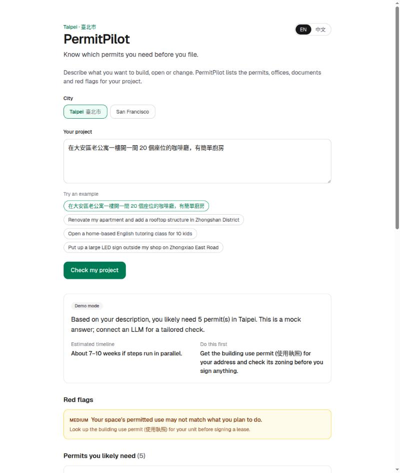

# PermitPilot

**Know which permits you need before you file.** AI permit pre-check for cities, starting with Taipei.

**Live demo:** https://permitpilot-mu.vercel.app



## The problem

Before you can open a café, renovate an apartment or put up a sign, you need permission from your city.
Nobody tells you up front what that means. In our Taipei data, a 20-seat café needs **5 permits from
4 different offices**. Most people find out what they missed when an application gets rejected, and
city staff spend their days sending incomplete applications back.

Every month of delay makes projects more expensive, and some never get built.

## What PermitPilot does

Describe your project in plain English or 中文. PermitPilot returns:

- **Permits** you likely need, with the office that handles each one, in English and the local language
- **Documents** to prepare, as a checklist
- **Red flags** that commonly get applications rejected (zoning, change of use, illegal additions)
- **Timeline** and the **one thing to do first**

## How it works

```
Browser ──POST /api/check──▶ Next.js API route (server)
                               ├─ loads the city's rules pack   src/data/cities/<city>.json
                               ├─ prompts an LLM with those rules + the user's project
                               ├─ validates the JSON answer with zod
                               └─ falls back to a rules-based answer if the LLM fails
```

- **Grounded:** the model may only use permits and offices from the city's rules pack, so it can't invent agencies.
- **Any city is data, not code:** a city is one JSON file. San Francisco runs on the same code as Taipei.
- **Any model:** works with any OpenAI-compatible API (GMI Cloud, OpenAI, …) via env vars.
- **Never blank:** with no API key, or if the model fails, the app still answers from the rules, and the badge says so.

### Add a city

1. Copy `src/data/cities/taipei.json` to `src/data/cities/<city-id>.json` and fill in its permits, offices and zoning notes.
2. Add `"<city-id>"` to `src/data/cities/index.json`.

## Why now

YC's Request for Startups calls for **AI for City Hall**: there are 19,000 US cities, and almost all of them still
review permits by hand. Faster permitting means more buildings and more property tax. PermitPilot starts with residents
(free pre-check) and grows into a staff-side tool that checks applications for completeness before a human reviews them.

## Run locally

```bash
npm install
cp .env.example .env.local   # add an LLM key, or leave it empty for demo mode
npm run dev                  # http://localhost:3000
```

| Env var | Example |
|---|---|
| `LLM_BASE_URL` | `https://api.gmi-serving.com/v1` |
| `LLM_API_KEY` | your key (server-side only) |
| `LLM_MODEL` | `deepseek-ai/DeepSeek-V3.2` |

**Stack:** Next.js (App Router), TypeScript, Tailwind CSS, zod, Vercel.

## Roadmap

- Staff mode: upload an application and get a completeness check against the rules pack
- Address lookup for real zoning per parcel
- More cities, starting with US cities with public permit data

> Rules data is simplified and demo-grade. Not legal advice. Always confirm with the responsible office.
